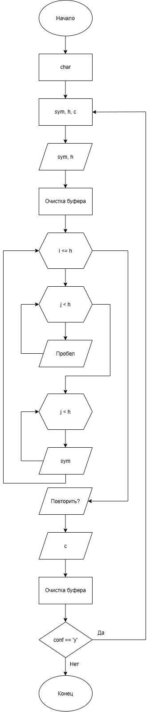

# Домашние задание к работе номер 9
## Условие Задачи
Написать программу, выводящую на экран заданную геометрическую фигуру, нарисованную с помощью заданного с клавиатуры символа, условие заполнения фигуры и задаваемые параметры фигуры в таблице
(равнобедренный треугольник).
## 1. Алгоритм и блок-схема
### Алгоритм:
1. Начало
2. Объявить переменную для ответа пользователя:
  - **conf** - для ответа пользователя повторять программу или нет (y/n).
3. Написать цикл do while, где в конце (conf == 'y') идёт проверка написания пользователем символа 'y'.
4. В теле цикла do while будут объявлены переменные:
- **sym** - символ, которым будет рисоваться треугольник;
- **h** - высота треугольника;
- **c** - временная переменная для чтения символов из потока ввода.
5. Циклы **while ((c = getchar()) != '\n')** будут расставлены для очищения входного буфера до конца строки.
6. В теле цикла будет написан цикл for, а внутри этого цикла будут написаны ещё два цикла for, один для вставления пробелов, а второй для вставления символов.
7. Задаётся вопрос пользователю, повторять ли программу, и читает ответ в **conf**.
8. Конец.
### Блок-схема:

## 2. Реализация программы
```c
#define _CRT_SECURE_NO_WARNINGS
#include <stdio.h>
#include <locale.h>

int main()
{
    setlocale(LC_ALL, "RUS");

    char conf;

    do {
        char sym;
        int h;
        int c;

        printf("Введите символ для рисования: ");

        scanf(" %c", &sym);

        while ((c = getchar()) != '\n');

        printf("Введите высоту треугольника: ");

        scanf("%d", &h);

        while ((c = getchar()) != '\n');

        for (int i = 1; i <= h; i++)
        {
            for (int j = 0; j < h - i; j++)
            {
                putchar(' ');
            }

            for (int j = 0; j < 2 * i - 1; j++)
            {
                putchar(sym);
            }

            putchar('\n');
        }

        puts("Повторить? (y - да, n - нет):");

        scanf(" %c", &conf);

        while ((c = getchar()) != '\n');

    } while (conf == 'y');

    return 0;
}
```
## 3. Результаты работы программы
Введите символ для рисования: -
Введите высоту треугольника: 7
Случай 1:
y
Введите символ для рисования:

Случай 2:
n
## 4. Информация о разработчике
Коваленко Вадим Валерьевич, бТИИ-261
